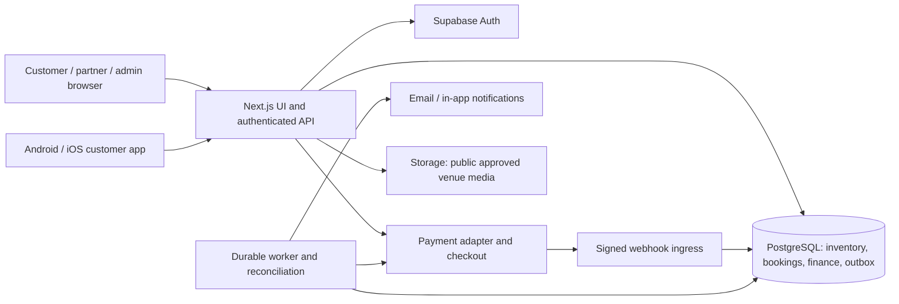

# Simply Sit — Technical Requirements Document

Version: planning baseline 1.0 · 25 October 2026. Status: **proposed technical design**. Owner confirmed the newer broader hospitality-space marketplace proposal as primary and website + Android + iOS together. Vendors, architecture details and commercial policies below remain proposals; provider eligibility, working integrations and deployments are unverified. Read `00-SOURCE-REVIEW-AND-DECISIONS.md` before implementation.

## 1. Build boundary and platforms

Build a mobile-first responsive website plus Android and iOS customer applications together, sharing one backend and core customer feature parity. Partner and admin dashboards are web applications. Support current stable mobile Safari/Chrome and desktop Chrome/Edge/Firefox plus selected Android/iOS device versions; record the actual browser/OS support matrix during setup. Offline browsing can follow; offline booking and check-in are excluded. Food ordering, delivery integration, per-seat capacity pooling, subscriptions, promotions and dynamic pricing are outside this baseline.

Proposed initial simplification: one physical table is one exclusive inventory unit, including in hotels, cafés, restaurants, breweries, lounges and workspaces. A party reserves the whole table within its capacity. This narrower table-first scope needs owner acceptance before enabling resource sales; seats/zones/whole spaces remain future resource kinds. Never sell a table and its encompassing zone simultaneously without a physical-capacity conflict model. Test first with one seeded venue; commercial pilot targets 5–10 approved venues in one city, with every operational/financial record scoped to venue and partner. Location search, list and map discovery are core scope. Manual location search works without precise-location permission; a map failure preserves the list and selection. Select a map provider before integrated pilot acceptance.

## 2. Proposed stack and deployment

| Layer | Proposal and reason | Tradeoff / decision gate |
|---|---|---|
| Frontend + server | Next.js App Router, React, TypeScript strict mode; shared validation schemas; semantic HTML and accessible components | One web stack reduces pilot maintenance. Confirm team capability and pin supported stable versions when scaffolding. |
| Customer mobile | Expo React Native + Expo Router, Android and iOS | Share domain types, validation, API client and design tokens; native/web UI and navigation need platform-specific implementation and testing. |
| Backend | Route handlers for versioned JSON APIs; server actions may call the same domain services | Do not duplicate business rules in handlers/actions. Keep routes deployable in a Node runtime. |
| Database | Supabase-managed PostgreSQL; `btree_gist` for inventory constraints; PostGIS for distance queries | Confirm selected project supports extensions and managed PostgreSQL version. No dependency on a new major-version-only feature. |
| Identity/storage | Supabase Auth and object storage; email OTP initially | Phone OTP requires selected SMS vendor, delivery costs and account setup. Storage access rules need independent tests. |
| Web hosting | Managed Next.js Node hosting, Vercel as candidate | Pick region close to database; verify plan, runtime limits and availability. Static export cannot implement the proposed backend. |
| Native builds/release | Expo EAS Build/Submit as candidate, store-owned signing and review | Owner controls Apple/Google/Expo accounts. Development builds are needed for selected native payment/map SDKs; validate actual SDK compatibility. Store submission/review is a release task, not proof that approval is guaranteed. |
| Durable work | Node worker on proposed AWS Lightsail Ubuntu VM in Mumbai, PostgreSQL outbox/job tables and leases; process supervisor and external watchdog | Hosted web request callbacks are not a durable queue. VM patching/restarts are an operations responsibility; managed container worker is an alternative. Database remains booking truth. |
| Payments | Adapter with deterministic fake provider locally; Razorpay Payments/marketplace product as candidate | KYC, merchant-of-record, collections, transfers and partner eligibility must be confirmed before live money. A successful ordinary payment integration does not approve marketplace settlements. |
| Email/monitoring/maps | Proposed Resend transactional email, Sentry error monitoring, Google Maps/Places | Owner holds accounts and budgets. Supabase+Resend SMTP/SDK configuration and native map SDK compatibility must be tested. Use outbox/redaction/restricted keys. |

Proposed primary database region: Supabase South Asia (Mumbai), `ap-south-1`, subject to actual plan/capacity and legal review. Co-locate Node worker in AWS Mumbai and choose Mumbai web compute where the selected hosting plan permits it; verify actual invocation region/latency. Supabase and Lightsail list Mumbai, but regional placement does not mean every provider process/log remains in India. Record actual deployment and provider data flows. Hosting, email, maps and workers must not silently send personal information to unreviewed services. [Supabase regions](https://supabase.com/docs/guides/platform/regions), [Lightsail regions](https://docs.aws.amazon.com/lightsail/latest/userguide/understanding-regions-and-availability-zones-in-amazon-lightsail.html), [Supabase data-location explanation](https://supabase.com/legal/privacy-resources/data-residency-and-transfers-faq).

Official Next.js guidance documents Node/server deployments, server environment variables and additional multi-instance cache requirements. Use deployment-specific documentation for the pinned version; treat availability responses as dynamic private/no-store data. [Next.js self-hosting](https://nextjs.org/docs/app/guides/self-hosting).

Proposed monorepo: `apps/web`, `apps/mobile`, `apps/worker`, `packages/contracts`, `packages/api-client`, `packages/design-tokens`, `packages/domain` (server-only) and `supabase/migrations`. Enforce import boundaries: mobile/shared client packages cannot import server secrets, provider SDK credentials or database mutation internals. EAS supports Android/iOS binary builds; store membership, signing, distribution profiles and review remain separate release inputs. [Expo EAS Build](https://docs.expo.dev/build/), [production builds](https://docs.expo.dev/deploy/build-project/).

### Integration setup and limits

These are recommended vendor defaults, with no accounts provisioned or prices committed. Owner/organization owns every account, billing method and recovery contact; engineers receive least-privilege access. Actual vendor quotas/pricing are checked when activating a plan. Proposed budget controls below are application guardrails, not claims about vendor plan limits. Allocate actual rupee caps from the approved operating budget before production; an unset cap blocks enabling that paid integration. Alert at 50/80/100% of its allocation. A billing alert alone is not a guaranteed hard spending limit.

| Provider / purpose | Credentials and test-mode requirement | Quota/budget controls and alternative |
|---|---|---|
| Supabase database/Auth/Storage | Organization project owner; publishable URL/key for clients; server secret and DB credentials only in server/worker secrets; isolated local/staging/prod | Monitor DB connection pool, storage/egress/Auth usage; fixed pilot compute size and owner-approved upgrades. Self-managed PostgreSQL + separate identity/storage is alternative with higher operations cost. |
| Vercel web/API | Owner team/project; CI deployment token scoped to project; per-environment secrets | Function concurrency/timeouts and plan spend alerts; maximum-instance/traffic controls where supported. Alternative Node container on owner-managed India infrastructure. |
| AWS Lightsail worker | Owner AWS account; scoped deployment identity, restricted SSH/instance access; test VM/staging DB | Proposed one small fixed VM initially, no automatic fleet scaling; monitor CPU/queue lag, restart service and watchdog. Alternative managed container worker after region/price review. Leases/outbox recover process crashes; VM memory alone never stores jobs. |
| Google Maps/Places discovery | Owner Google Cloud project/billing; distinct restricted web/Android/iOS/server keys; development restrictions separate | Proposed pilot cap 2,000 map loads/day and 1,000 Places/autocomplete requests/day, with provider SKU quotas where supported, debouncing and session-token usage per current docs. Manual area catalogue/list remains usable on quota failure. Alternative Mapbox after India coverage/terms/cost test. |
| Resend email + Auth SMTP | Owner verified sending domain and DNS access; server sending key/SMTP credentials, separate staging recipient allowlist | Proposed app throttle 2 send requests/sec and 1,000 transactional emails/day, adjusted below actual account allowance; OTP anti-abuse shares delivery budget. Outbox defers noncritical messages, in-app stays available. Alternative Amazon SES after deliverability/setup review. Free-plan availability is not production capacity approval. |
| Sentry errors/crashes | Owner organization; separate web/server/mobile projects and public ingestion DSN; upload/auth tokens CI-only | Proposed 5,000 error events/month, 10% sampled traces, replay off initially; SDK field allowlist/scrubbing and vendor volume controls. Keep request IDs, remove identity/contact/payment/QR/location fields. Alternative self-hosted monitoring after maintenance estimate. |
| Razorpay payment adapter | Owner approved merchant/marketplace account; test/live key pairs and webhook secrets server-only; client checkout receives only public key/order config | Test-mode capture/refund/reorder/late-event evidence before live activation. Monitor payment/refund rate limits and per-transaction fees against unit economics; disable new checkout on reconciliation incident. Cashfree or another India-capable provider is alternative only after equivalent eligibility and native SDK assessment. |
| Expo EAS + Apple/Google stores | Owner Expo organization, organization-owned bundle IDs/store memberships/signing; CI tokens server-side | Separate development/preview/production profiles; internal/TestFlight tests; owner approves cloud-build concurrency/volume and update channels. Alternative local native CI with maintained Android/macOS build capacity. No store submission implied. |

Google recommends application/API restrictions and quotas for abuse/cost control; configure platform-specific restrictions and avoid calling secret server APIs directly from apps. Resend documents account-specific sending quotas/rate limits; inspect actual account limits and handle 429/retry. Sentry exposes data/IP scrubbing controls; enable and verify redaction with synthetic payloads. [Maps key restrictions](https://developers.google.com/maps/api-security-best-practices), [Maps cost controls](https://developers.google.com/maps/billing-and-pricing/manage-costs), [Resend quotas](https://resend.com/docs/knowledge-base/account-quotas-and-limits), [Sentry scrubbing controls](https://docs.sentry.io/api/organizations/update-an-organization/). Checked 25 October 2026.

## 3. Components and data flow

Domain modules: identity/access, venue catalogue, availability/pricing, booking lifecycle, payments/refunds, partner operations, settlement/reconciliation, notifications and support. UI never writes financial or inventory state directly. A PostgreSQL transaction function or transaction-capable server connection performs each atomic mutation; a sequence of independent REST writes is insufficient. Provider HTTP calls happen outside database transactions. Atomic state changes emit outbox events in the same commit.

Search returns advisory availability and a priced quote. Checkout revalidates the quote and reserves a table atomically. The server creates a provider order associated with the hold. Browser checkout results trigger server verification; verified provider state may also arrive through signed webhooks/reconciliation. Only the database transition to `CONFIRMED` enables confirmation, QR and booking notifications. Clients re-fetch on app resume and after actions; optional realtime events request a fresh fetch and do not authorize transitions.

## 4. Inventory, time and pricing contracts

Proposed defaults, pending owner decision: 60–240-minute duration; start/duration aligned to 30 minutes; fifteen-minute booking lead time; thirty-day booking horizon; five-minute checkout hold; ten-minute cleaning buffer after booked end; fifteen-minute arrival grace; end reminder ten minutes before booked end; cancellation at least two hours before start receives the accepted full customer-payment refund, later customer cancellation receives zero; partner/service-failure cancellation receives a full refund. No-show and early departure receive zero refund and retain the paid slot. These are configurable policy versions, never hardcoded commercial promises. Commission, tax and payout schedule remain explicit configuration decisions. Fail closed where required configuration is missing.

Store instant timestamps as `timestamptz` in UTC; retain venue IANA timezone `Asia/Kolkata` and render venue-local dates with the timezone label. Validate hours in venue-local time including overnight ranges. Persist quote arithmetic in integer paise with explicit `INR`; never floating point. Server price snapshots include base, service fee, tax lines, discount zero for MVP, total, commission allocation, policy version and rate version. No invented tax rate or commission. Capture acceptance of the exact quoted rules and policy hash/version.

Every held/confirmed table uses a half-open blocked interval `[start_at, end_at + buffer)`. For example, 10:00–11:00 with ten-minute buffer conflicts with a new 11:00 booking but permits 11:10 only if the configured time grid allows it. Do not round silently. Cleanup applies between bookings and within opening hours unless an explicitly versioned rule permits staff cleanup after closing.

All inventory-changing operations lock the venue row, then table rows in sorted UUID order, then booking/payment rows in stable order. The pilot accepts per-venue serialization for correctness. Recheck listing status, hours, closures, capacity, quote versions, deadlines and table conflicts inside that transaction. Expire due holds/extensions in the same lock path before checking overlap; background expiry is also required. Never put `now()` into an index predicate or assume time passing changes an index entry. Use an exclusion constraint as the last line of defense; map its conflict to a recoverable `409`.

For deadline checks, sample PostgreSQL `clock_timestamp()` after acquiring the required locks and use that sampled instant consistently in the transition; transaction-start `now()` can become stale while waiting for a lock. Hold creation/expiry uses the database clock, never the device clock.

PostgreSQL documents timestamp ranges and GiST exclusion constraints for non-overlap; row locks provide transaction coordination. These support the proposed design, which still requires concurrent integration tests. [Range constraints](https://www.postgresql.org/docs/current/rangetypes.html#RANGETYPES-CONSTRAINT), [explicit locking](https://www.postgresql.org/docs/current/explicit-locking.html).

Table readiness is operational state, separate from future reservation claims. Checkout sets `CLEANING`; staff mark `READY` after actual turnover. Buffer expiry does not mark a table ready. Overdue cleaning or overstay pauses new immediately affected sales and raises an operational alert; a future confirmed reservation is never silently cancelled or displaced. Check-in is blocked until ready or routed through documented service recovery. Early checkout does not automatically resell the remaining paid interval.

## 5. Identity, roles and security

Public users can browse approved listings; authentication is required before holding inventory. Proposed pilot sign-in: email OTP, verified through Supabase, with generic request responses, resend cooldown, rate limits, allowlisted redirect destinations and no OTP values in logs. Configure the email template for a numeric OTP rather than assuming the default template sends one. Existing account recovery uses a new verified OTP; there is no password-reset flow in an OTP-only pilot. Use provider session rotation/refresh and documented SSR cookie handling; verify identity on the server for every protected action. Sign-out invalidates the chosen session scope and clears local state; deactivation additionally revokes sessions and is checked on each protected mutation.

Web uses SSR-compatible session cookies with CSRF/origin checks. Native uses short-lived access tokens in memory and provider session persistence via an encrypted secure-storage adapter; validate storage errors/size limits, refresh on app resume and clear credentials on sign-out. Send bearer tokens only to the allowlisted HTTPS API origin. Protected mobile routes improve navigation but never replace server authorization. Booking deep links carry a public booking reference, not a QR token/session secret, and require sign-in/ownership checks. Payment return deep links only initiate verification; killed/resumed apps re-fetch status. [Expo protected routes](https://docs.expo.dev/router/advanced/authentication/), [SecureStore](https://docs.expo.dev/versions/latest/sdk/securestore/).

Roles: customer, venue staff, venue manager/partner owner, support admin, finance admin and platform superadmin. Active venue membership defines tenant access. Customers can also hold partner roles; roles are server-controlled membership records, never editable profile metadata. Staff see booking reference, party size, slot and check-in state; customer contact, full financial records and payout data are excluded. Finance admins handle refunds/settlement; support admins investigate and propose remedies; superadmins approve membership and listings. Require MFA and recent reauthentication for privileged actions, refund approval and payout-detail changes. Bootstrap one admin using an explicit owner-controlled process; no default privileged seed account.

Enable RLS on all exposed tables, deny writes unless listed in the schema matrix, and expose limited views/procedures for safe fields. Supabase secret/service-role credentials bypass RLS; isolate them to the trusted worker/admin adapter and perform explicit actor/venue checks before privileged writes. Public/publishable project keys are not user authorization. [Supabase RLS](https://supabase.com/docs/guides/database/postgres/row-level-security), [API keys](https://supabase.com/docs/guides/api/api-keys).

Use secure deployment cookies, CSRF/origin checks for cookie-authenticated writes, strict input/output schemas, rate limits, safe error messages, CSP and restrictive upload limits. Validate MIME and image content; strip metadata from approved venue photos. Keep sensitive identity/payout documents in the provider's protected workflow where possible, storing opaque references only. QR tokens are random opaque secrets, stored as hashes, returned only to the booking owner and verified by assigned staff; redact them from URLs/logs. Manual lookup is an authenticated staff action with audit and a secondary verification step.

Persist no continuous location history, card/PAN/CVV, Aadhaar image, raw bank credentials or OTP. OTP is transient verification input only, never stored/logged by the application. Manual search is sufficient. Use aggregate analytics and event IDs instead of emails or precise coordinates. Define consent, export, erasure, support access and retention before real customers. Review actual India privacy, tax, payments and consumer obligations with appropriate specialists; this technical plan does not determine legal compliance.

Supabase documents cookie-based SSR using its SSR client package and the email-template distinction between links and OTPs. Use current provider validation guidance when implementing. [SSR clients](https://supabase.com/docs/guides/auth/server-side/creating-a-client?framework=nextjs), [email OTP API](https://supabase.com/docs/reference/javascript/auth-signinwithotp).

## 6. Payment correctness and asynchronous work

Payment state, booking state, refund state and payout state are independent. “Checkout successful” means verification is underway. Exact currency, captured amount, provider order/payment identity and environment must match the server-created expected payment. Authorized-but-not-captured funds cannot confirm a paid booking. A provider timeout is `UNKNOWN`, not failure or success; reconcile before issuing a new operation.

The strict proposed hold rule: confirmation transaction must acquire locks and observe `db_now < expires_at`, an unreleased claim and verified capture. A late captured payment after expiry/cancellation/release creates a refund liability and refund job; it never resurrects inventory. An authorized late payment is not captured; void it if the approved adapter supports that operation. Repeated capture events create one ledger posting and one confirmation/refund outcome. Extensions use the same protection and never move the original end until their payment is verified. See `07-API-AND-STATE-MACHINES.md`.

Webhook ingress validates the signature against the raw body and environment-specific secret before durable event insertion. Respond `2xx` only after that commit; duplicate known event IDs return `2xx`. Unknown/out-of-order events are preserved for reconciliation without regressing state. Do not trust IP filtering as signature verification. Razorpay documents asynchronous, duplicate and potentially unordered events and raw-body signature validation. [Webhook practices](https://razorpay.com/docs/webhooks/best-practices/), [validation](https://razorpay.com/docs/webhooks/validate-test/).

Workers lease outbox records, retry with backoff, persist attempts and dead-letter exhausted work. Unique business-event keys prevent duplicate notifications and financial jobs. One-minute expiry sweeps are proposed; transactions enforce deadlines independently. Reconcile pending/unknown money operations every five minutes and daily provider payment/refund/settlement totals. Alert on mismatches; do not manufacture a balanced report. Freeze the affected payout allocation until resolved. Refund reservations, disputes and unreconciled transactions reduce partner available payable before creating a payout batch. Provider initiation is `PROCESSING`; `PAID` requires provider/bank settlement evidence.

## 7. Proposed measurable targets and release evidence

These are pilot engineering budgets, not existing performance measurements: 100 listed venues, 1,000 tables, 50 concurrent active sessions and 10 concurrent checkout attempts; verify realistic workload with owner. API p95 search/detail under 1 second and inventory mutation under 1.5 seconds excluding external provider time; p75 mobile LCP under 2.5 seconds in a documented test profile. Booking correctness target: zero overlapping active claims. Customer-visible payment processing exceeding 60 seconds shows pending/help, never false success. Queue lag above two minutes, unreconciled capture above fifteen minutes and all payout mismatches alert operations. Proposed 99.5% monthly service availability; provider outage effects reported separately.

Proposed RPO 24 hours and RTO four hours require an actual backup plan and restore drill; select PITR if affordable and compatible. Back up database and required private storage, document encryption/access and retention, and test restoring into isolated staging. Backups alone do not satisfy the restore target. Observe request IDs, transition IDs, job lag, expiry lag, denied cross-tenant access, webhook failures, captured-unallocated money and reconciliation differences without private payloads.

Use distinct development, staging and production projects, payment modes, web origins, native app identifiers/schemes, email recipients and secrets. CI runs formatting/lint, typecheck, meaningful unit tests, PostgreSQL integration/RLS/concurrency tests, web end-to-end journeys, Android/iOS critical-flow device tests and all target builds. Validate screen-reader labels, dynamic text, keyboard avoidance, permission denial, app-killed payment recovery and native back/deep-link behavior. Proposed native budgets: critical authenticated screen p95 ready within two seconds on a documented mid-range device/network profile, excluding provider checkout; crash-free sessions above 99.5% during measured pilot. Keep API compatibility for the previous shipped native version and force-update only through an approved recovery plan. Apply additive migrations in staging first; use expand/contract for breaking changes, forward repair for financial data and application rollback compatible with current schema. Native signing/store review and platform privacy disclosures are release gates. No production accounts, credentials, funds or deployments are created by this document.
